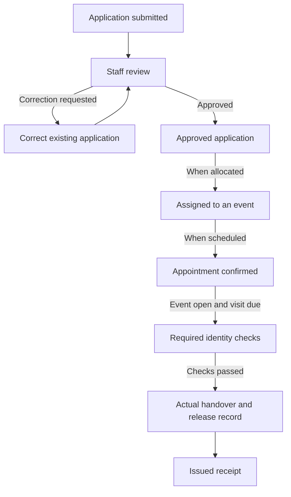

# GarantiyAid beneficiary chatbot: 40 FAQ drafts

Prepared November 10, 2026. Status: for staff review, not an approved government procedure or a published chatbot update.

Questions are provided in English and Cebuano. Suggested replies use Cebuano. These replies explain the implemented software workflow and identify what the responsible office must confirm; no agency-specific eligibility rule, benefit amount, document checklist, deadline, or contact number is supplied here.

## Current capability boundaries

- Public beneficiary help gives general guidance. It cannot retrieve personal application, schedule, claim, or eligibility records.
- Staff tools require authentication, role permissions, and the appropriate service-area scope.
- SMS via SimGate has been tested with two explicitly authorized recipients, who confirmed receipt. A gateway acceptance by itself still does not prove recipient delivery.
- Mobile account-linking endpoints are prepared, but the beneficiary mobile app is not present in this workspace. Actual integration must be verified separately.
- The current push-notification workspace saves drafts; it does not deliver notifications to beneficiary phones.
- The staff assistant supports formatted text, lists and tables. Staff and public help now support fixed general-process diagrams. Personal-progress and interactive status illustrations described below remain proposals; public chat cannot retrieve personal records.

## 1. Available programs and eligibility

### FAQ 01
- **Category:** Available programs and eligibility
- **English question:** What government assistance programs can I apply for?
- **Cebuano question:** Unsang mga programa sa ayuda ang pwede nako maaplayan?
- **Suggested answer:** Pangayoa sa inyong barangay o sa opisina nga nagdumala ang kasamtangang listahan sa bukas nga programa. Lahi-lahi ang requirements ug application period sa matag programa.
- **Intent:** `PROGRAM_AVAILABILITY`
- **Refer to staff when:** No current, approved program list is available, or the person needs an official application opening confirmed.

### FAQ 02
- **Category:** Available programs and eligibility
- **English question:** How do I know whether I qualify for a particular program?
- **Cebuano question:** Unsaon nako pagkahibalo kung kwalipikado ko sa maong programa?
- **Suggested answer:** Tan-awa ang opisyal nga qualifications sa maong programa. Ang staff maoy mo-review sa imong aplikasyon ug ebidensya; dili ko makadesisyon sa imong personal nga eligibility dinhi sa public chat.
- **Intent:** `PROGRAM_ELIGIBILITY`
- **Refer to staff when:** A personal eligibility decision or interpretation of an unclear program rule is required.

### FAQ 03
- **Category:** Available programs and eligibility
- **English question:** Am I automatically qualified because I am a senior citizen or a person with a disability?
- **Cebuano question:** Automatic ba ko nga kwalipikado kay senior citizen ko o PWD?
- **Suggested answer:** Dili ko makaingon nga automatic kang kwalipikado. Ipa-check sa staff ang qualifications sa espesipikong programa ug unsang ebidensya ang kinahanglan para sa imong kahimtang.
- **Intent:** `SENIOR_PWD_ELIGIBILITY`
- **Refer to staff when:** The person needs confirmation of a category, accommodation, or program-specific entitlement.

### FAQ 04
- **Category:** Available programs and eligibility
- **English question:** Can I apply for another program if I already received assistance elsewhere?
- **Cebuano question:** Pwede pa ba ko mo-apply sa laing programa kung nakadawat na ko og laing ayuda?
- **Suggested answer:** Ipa-check sa nagdumalang opisina ang ilang rules bahin sa pagdawat og tabang gikan sa lain-laing programa. Ayaw paghimo og laing identity record aron makasumite pag-usab.
- **Intent:** `MULTIPLE_PROGRAM_APPLICATIONS`
- **Refer to staff when:** Overlapping assistance, prior receipt, or duplicate-benefit restrictions need interpretation.

## 2. Application steps and required documents

### FAQ 05
- **Category:** Application steps and required documents
- **English question:** How do I start an application in GarantiyAid?
- **Cebuano question:** Unsaon nako pagsugod og aplikasyon sa GarantiyAid?
- **Suggested answer:** Pakig-ugnayan sa authorized barangay o program staff aron ma-check ang existing beneficiary record ug ang programa nga imong aplayan. Sa current staff workflow, i-record sa staff ang details ug required documents una isumite ang enrollment para sa review.
- **Intent:** `APPLICATION_START`
- **Refer to staff when:** An existing record must be located, an application must be submitted, or the office's application channel is unclear.

### FAQ 06
- **Category:** Application steps and required documents
- **English question:** Which documents do I need to submit?
- **Cebuano question:** Unsang mga dokumento ang akong isumite?
- **Suggested answer:** Depende kini sa imong giaplayan nga programa. Pangayoa ang current official checklist sa staff; dili pareho ang requirements sa tanang programa.
- **Intent:** `REQUIRED_DOCUMENTS`
- **Refer to staff when:** The program checklist is unavailable, outdated, unclear, or differs from what the person was told.

### FAQ 07
- **Category:** Application steps and required documents
- **English question:** What if I do not have the identification document requested by the office?
- **Cebuano question:** Unsaon kung wala koy ID nga gipangayo sa opisina?
- **Suggested answer:** Pangutan-a ang staff kung unsang alternatibong dokumento ang ilang madawat alang sa maong programa. Ayaw paggamit og ID sa laing tawo o paghimo og peke nga dokumento.
- **Intent:** `MISSING_IDENTIFICATION_DOCUMENT`
- **Refer to staff when:** An alternative document or an exception to the checklist must be officially approved.

### FAQ 08
- **Category:** Application steps and required documents
- **English question:** Can a family member help me fill out my application?
- **Cebuano question:** Pwede ba akong kapamilya ang motabang sa pag-fill out sa akong aplikasyon?
- **Suggested answer:** Mahimo kang mangayo og tabang sa pagsabot ug pag-andam sa imong details. I-confirm sa staff ang ilang pamaagi sa assisted applications; ang impormasyon ug identity kinahanglan sa tinuod nga aplikante gihapon.
- **Intent:** `ASSISTED_APPLICATION`
- **Refer to staff when:** Consent, authorization, accessibility support, or who may submit on the person's behalf needs confirmation.

## 3. Application status and record access

### FAQ 09
- **Category:** Application status and record access
- **English question:** How can I check my application status?
- **Cebuano question:** Unsaon nako pag-check sa status sa akong aplikasyon?
- **Suggested answer:** Gamita ang opisyal nga account channel kung available ug konektado na sa imong record, o kontaka ang authorized staff. Dili nako makita ang imong personal nga application status dinhi sa public chat; ayaw ipadala dinhi ang imong password, OTP o full ID number.
- **Intent:** `APPLICATION_STATUS`
- **Refer to staff when:** A private record must be checked, account ownership is unclear, or no connected account channel is available.

### FAQ 10
- **Category:** Application status and record access
- **English question:** My application says pending or for validation. What does that mean?
- **Cebuano question:** Pending o for validation pa akong aplikasyon. Unsay pasabot ana?
- **Suggested answer:** Wala pa mahuman ang review sa imong aplikasyon. Ipa-check sa staff kung adunay kulang nga dokumento o kinahanglan tubagon; dili pa kini pasabot nga approved o naa nay claim schedule.
- **Intent:** `APPLICATION_PENDING`
- **Refer to staff when:** The person needs the actual outstanding requirement, assigned reviewer, or an office-approved follow-up time.

### FAQ 11
- **Category:** Application status and record access
- **English question:** My application is approved. When will I receive assistance?
- **Cebuano question:** Approved na akong aplikasyon. Kanus-a nako madawat ang ayuda?
- **Suggested answer:** Ang approval lahi pa sa pag-assign sa distribution event ug paghatag og appointment. I-confirm sa staff kung na-allocate ug na-schedule na ka, ug unsa ang opisyal nga petsa, oras ug venue.
- **Intent:** `APPROVED_AWAITING_SCHEDULE`
- **Refer to staff when:** Approval has no corresponding appointment, or the person needs a confirmed release schedule.

### FAQ 12
- **Category:** Application status and record access
- **English question:** Can you check my spouse's or neighbor's application for me?
- **Cebuano question:** Pwede nimo ma-check ang aplikasyon sa akong asawa, bana o silingan?
- **Suggested answer:** Dili ko makahatag og personal nga impormasyon sa laing tawo dinhi. Ang authorized staff kinahanglan mo-check sa identity ug bisan unsang required authorization sa dili pa maghisgot sa ilang record.
- **Intent:** `OTHER_PERSON_RECORD_ACCESS`
- **Refer to staff when:** Someone requests another person's information or claims to be an authorized representative.

## 4. Corrections, rejected applications, and duplicate records

### FAQ 13
- **Category:** Corrections, rejected applications, and duplicate records
- **English question:** The reviewer requested a correction. Do I need to apply again?
- **Cebuano question:** Gipabalik akong aplikasyon para correction. Kinahanglan ba ko mo-apply pag-usab?
- **Suggested answer:** Ipa-explain sa staff ang recorded correction request. Sa current workflow, ang staff mo-update sa kulang o sayop ug mo-resubmit sa existing enrollment; dili kinahanglan maghimo dayon og laing beneficiary record.
- **Intent:** `APPLICATION_CORRECTION_REQUEST`
- **Refer to staff when:** The correction reason is unclear, a replacement document needs review, or the existing case cannot be reopened.

### FAQ 14
- **Category:** Corrections, rejected applications, and duplicate records
- **English question:** My name or birth date is incorrect. How can I correct it?
- **Cebuano question:** Sayop akong pangalan o birthday sa record. Unsaon pag-correct?
- **Suggested answer:** Ipa-correct kini sa authorized staff ug ipakita ang ebidensya nga ilang pangayoon pinaagi sa opisyal nga channel. Ayaw paghimo og bag-ong record aron lang mausab ang sayop nga detail.
- **Intent:** `IDENTITY_DETAILS_CORRECTION`
- **Refer to staff when:** Any identity detail must change or the evidence conflicts with another record.

### FAQ 15
- **Category:** Corrections, rejected applications, and duplicate records
- **English question:** My application was rejected. Can I ask for a review or apply again?
- **Cebuano question:** Na-reject akong aplikasyon. Pwede ba ipa-review o mo-apply pag-usab?
- **Suggested answer:** Pangayoa sa staff ang recorded reason ug ang opisyal nga pamaagi sa review o reapplication, kung adunay ingon ana nga pamaagi ang programa. Dili ko makagarantiya nga mausab ang decision o nga bukas pa ang application period.
- **Intent:** `APPLICATION_REJECTION_REVIEW`
- **Refer to staff when:** A rejection is disputed or the program's review and reapplication rules must be confirmed.

### FAQ 16
- **Category:** Corrections, rejected applications, and duplicate records
- **English question:** Staff found two similar records for me. Will I lose my application?
- **Cebuano question:** Naay duha ka parehas og details nga record para nako. Mawala ba akong aplikasyon?
- **Suggested answer:** Kinahanglan susihon sa staff kung duplicate ba gyud kini o lahi nga tawo nga parehas og ngalan. Ayaw paghimo og ikatulong record; dili ko makadesisyon dinhi kung unsang record ang sakto o unsay epekto sa imong application.
- **Intent:** `DUPLICATE_RECORD_REVIEW`
- **Refer to staff when:** There is a possible duplicate, conflicting identity information, or a proposed record merge.

## 5. Distribution dates, places, and queues

### FAQ 17
- **Category:** Distribution dates, places, and queues
- **English question:** Where and when should I go for my distribution appointment?
- **Cebuano question:** Asa ug kanus-a ko moadto para sa akong distribution appointment?
- **Suggested answer:** I-confirm ang imong kaugalingong appointment pinaagi sa opisyal nga account channel kung available, o sa authorized staff. Sunda ang confirmed nga petsa, time slot ug venue; dili nako makumpirma ang personal schedule pinaagi sa public chat.
- **Intent:** `DISTRIBUTION_APPOINTMENT_DETAILS`
- **Refer to staff when:** A personal schedule is missing, conflicting, changed, or cannot be authenticated.

### FAQ 18
- **Category:** Distribution dates, places, and queues
- **English question:** There is a TUPAD distribution in Punta today. Can every TUPAD beneficiary there claim?
- **Cebuano question:** Naay TUPAD distribution sa Punta karon. Pwede tanan TUPAD beneficiaries didto mo-claim?
- **Suggested answer:** Ang announcement lang dili pasabot nga apil ang tanan sa maong distribution. Ipa-check kung naa ka sa official list ug schedule para sa exact event, ug i-confirm sa nagdumalang opisina ang applicable claiming requirements.
- **Intent:** `ANNOUNCEMENT_VERSUS_PERSONAL_APPOINTMENT`
- **Refer to staff when:** The person assumes that program membership, location, or a general announcement guarantees a claim.

### FAQ 19
- **Category:** Distribution dates, places, and queues
- **English question:** What is the difference between whole-barangay and Sitio/Purok scheduling?
- **Cebuano question:** Unsay kalahian sa whole barangay ug by Sitio/Purok nga schedule?
- **Suggested answer:** Sa whole-barangay setup, ang allocated beneficiaries ibutang sa available sessions sumala sa capacity. Sa by Sitio/Purok setup, kinahanglan motakdo ang ilang recorded area sa sakop sa session; dili kini automatic nga eligibility para sa tanang residente.
- **Intent:** `SERVICE_AREA_SCHEDULING`
- **Refer to staff when:** A person's recorded area is wrong, their area has no covering session, or their appointment needs adjustment.

### FAQ 20
- **Category:** Distribution dates, places, and queues
- **English question:** My appointment is cancelled, but my allocation still exists. What should I do?
- **Cebuano question:** Cancelled akong appointment pero naa pa akong allocation. Unsay buhaton nako?
- **Suggested answer:** Ipa-review sa authorized staff ang cancelled appointment. Sa draft event, mahimo nilang i-reactivate ang existing schedule kung valid pa ang allocation, service area ug slot capacity; dili kini i-restore pinaagi lang sa pag-generate og bag-ong schedules.
- **Intent:** `CANCELLED_APPOINTMENT_REVIEW`
- **Refer to staff when:** A cancelled appointment needs review, the event has already opened, or the original slot cannot accept the person.

## 6. QR credentials and identity verification

### FAQ 21
- **Category:** QR credentials and identity verification
- **English question:** Where do I get my QR card, and how do I use it?
- **Cebuano question:** Asa ko mokuha sa akong QR card ug unsaon paggamit ani?
- **Suggested answer:** Kung QR ang verification method sa imong event, ang authorized staff maoy mo-issue sa credential para sa imong scheduled appointment human ma-open ang event. Ipresentar ang imong current card sa authorized verifier; lahi ang QR credential sa ordinary beneficiary ID o claim reference.
- **Intent:** `QR_CREDENTIAL_ISSUANCE_AND_USE`
- **Refer to staff when:** The person has no issued credential, the card belongs to another event, or its delivery must be arranged.

### FAQ 22
- **Category:** QR credentials and identity verification
- **English question:** I lost my QR card. What should I do?
- **Cebuano question:** Nawala akong QR card. Unsa akong buhaton?
- **Suggested answer:** Kontaka ang authorized staff aron ma-check kung pwede pang mag-issue og replacement para sa imong appointment. Kung ma-replace, ma-invalid ang daang credential; ayaw gamita ang card sa laing tawo o ipadala ang raw QR value dinhi sa chat.
- **Intent:** `LOST_QR_CREDENTIAL`
- **Refer to staff when:** Any replacement is requested, or the credential is expired, used, or linked to an existing claim.

### FAQ 23
- **Category:** QR credentials and identity verification
- **English question:** I took a photo, but the system says there is no enrolled face profile. Why?
- **Cebuano question:** Naka-take na ko og photo pero wala kunoy enrolled face profile. Ngano man?
- **Suggested answer:** Ang pagkuha og photo lahi pa sa pag-enroll sa face profile. Kung required ang face check, ipa-check sa staff ang imong consent ug kung nasave ug na-clear na ang reference profile; ang mobile profile picture dili automatic nga biometric enrollment.
- **Intent:** `FACE_PROFILE_NOT_ENROLLED`
- **Refer to staff when:** Consent, enrollment, duplicate review, profile clearance, or an unavailable face service needs attention.

### FAQ 24
- **Category:** QR credentials and identity verification
- **English question:** Face matching failed. Can I use my QR card or signature instead?
- **Cebuano question:** Wala ni-match akong nawong. Pwede QR o pirma na lang?
- **Suggested answer:** Depende kini sa verification rule sa imong event. Kung allowed ang QR OR face match, mahimong gamiton ang valid nga permitted alternative; kung BOTH ang required, dili nato mahimong laktawan ang face check o ilisan og pirma nga walay applicable rule.
- **Intent:** `IDENTITY_CHECK_FAILURE_OR_ALTERNATIVE`
- **Refer to staff when:** A required check fails, equipment is unavailable, or an alternative or exception is requested.

## 7. Actual assistance, handovers, and receipts

### FAQ 25
- **Category:** Actual assistance, handovers, and receipts
- **English question:** My claim says verified or checked in. Does that mean I have already received assistance?
- **Cebuano question:** Verified o checked in na akong claim. Pasabot nadawat na nako ang ayuda?
- **Suggested answer:** Dili pa na pareho sa actual release. Sa physical-assistance event, kinahanglan gihapong ihatag ug i-record sa staff ang handover una ma-issue ang resibo.
- **Intent:** `VERIFICATION_VERSUS_RELEASE`
- **Refer to staff when:** The person is verified but cannot find a release record, or a release is incorrectly recorded.

### FAQ 26
- **Category:** Actual assistance, handovers, and receipts
- **English question:** I received fewer items or a different package than expected. What should I do?
- **Cebuano question:** Kulang o lahi ang package nga akong nadawat. Unsay buhaton nako?
- **Suggested answer:** Ipahibalo dayon sa authorized release staff ang kalainan ug ipa-check ang event package ug recorded quantity. Ayaw i-acknowledge ang quantity nga wala nimo nadawat; kung na-record na, pangayo og formal review sa concern.
- **Intent:** `ASSISTANCE_QUANTITY_OR_PACKAGE_CONCERN`
- **Refer to staff when:** There is any discrepancy, disputed acknowledgment, or request to correct a recorded handover.

### FAQ 27
- **Category:** Actual assistance, handovers, and receipts
- **English question:** How do I get another copy of my receipt, or report incorrect details on it?
- **Cebuano question:** Unsaon pagkuha og laing kopya sa resibo o pag-report sa sayop nga details niini?
- **Suggested answer:** Pangayo sa authorized staff nga ablihan ug i-reprint ang existing issued receipt human ma-verify ang imong identity. Kung adunay sayop, ipa-review ang original record; ang pag-reprint kinahanglan dili maghimo og ikaduhang release o bag-ong receipt para lang mausab ang details.
- **Intent:** `RECEIPT_COPY_OR_RECORD_CONCERN`
- **Refer to staff when:** A receipt must be retrieved, a discrepancy is reported, or no issued receipt exists after a recorded release.

### FAQ 28
- **Category:** Actual assistance, handovers, and receipts
- **English question:** Can my representative claim the assistance for me?
- **Cebuano question:** Pwede ba akong representative ang mo-claim sa ayuda para nako?
- **Suggested answer:** I-confirm una sa nagdumalang opisina kung gitugotan ang representative ug unsang authorization ug identity checks ang ilang gikinahanglan. Ang paghatag lang sa imong QR card sa kapamilya dili automatic nga permission nga siya ang mo-claim.
- **Intent:** `REPRESENTATIVE_CLAIM_POLICY`
- **Refer to staff when:** Any representative claim, incapacity, authorization document, or accommodation must be considered.

## 8. SMS, phone numbers, and mobile notifications

### FAQ 29
- **Category:** SMS, phone numbers, and mobile notifications
- **English question:** I did not receive an SMS. Can I still claim assistance?
- **Cebuano question:** Wala ko kadawat og SMS. Pwede gihapon ko mo-claim?
- **Suggested answer:** Ang SMS usa ka pahibalo; dili kini claim authorization, ug ang pagkawala niini dili igo aron makadesisyon kung eligible ka o dili. Ipa-check sa authorized staff ang imong official appointment ug required checks sa dili pa moadto o mo-claim.
- **Intent:** `MISSING_SMS`
- **Refer to staff when:** A personal appointment must be confirmed or a delivery problem prevents the person from getting their instructions.

### FAQ 30
- **Category:** SMS, phone numbers, and mobile notifications
- **English question:** Staff said the SMS was accepted by the gateway, but I still have no message. What now?
- **Cebuano question:** Ingon ang staff nga gidawat na sa gateway ang SMS, pero wala pa koy nadawat. Unsaon ni?
- **Suggested answer:** Ang gateway acceptance dili pa confirmation nga naa na ang text sa imong inbox. Ipa-check sa staff ang actual delivery record ug sakto nga contact number; tan-awa sab ang SMS inbox ug spam folder sa imong phone. Dili kinahanglan balik-balikon dayon ang send.
- **Intent:** `SMS_ACCEPTED_NOT_RECEIVED`
- **Refer to staff when:** The message does not arrive, the number may be wrong, or gateway/device troubleshooting is necessary.

### FAQ 31
- **Category:** SMS, phone numbers, and mobile notifications
- **English question:** My registered mobile number is wrong or I no longer use that SIM. How can I update it?
- **Cebuano question:** Sayop akong mobile number sa record o wala na nako gamita ang SIM. Unsaon pag-update?
- **Suggested answer:** Kontaka ang authorized staff pinaagi sa opisyal nga channel aron ma-verify ang imong identity ug ma-update ang contact. Ayaw ibutang ang full number, OTP o account password dinhi sa public chat.
- **Intent:** `CONTACT_NUMBER_CORRECTION`
- **Refer to staff when:** A contact change is requested or someone may still receive messages intended for the beneficiary.

### FAQ 32
- **Category:** SMS, phone numbers, and mobile notifications
- **English question:** Why do I receive SMS but no notification inside the beneficiary mobile app?
- **Cebuano question:** Ngano makadawat ko og SMS pero walay notification sa beneficiary mobile app?
- **Suggested answer:** Lahi ang SMS ug mobile push notification. Sa current version nga na-review, wala pa konektado ang actual push delivery; sa umaabot nga connected mobile version, kinahanglan sab ma-register ang device ug ma-enable ang notifications. Ayaw hunahunaa nga wala kay appointment tungod lang kay walay push alert.
- **Intent:** `MOBILE_PUSH_AVAILABILITY`
- **Refer to staff when:** Current app integration must be confirmed, the phone's notification settings need assistance, or a personal schedule is in doubt.

## 9. Access without a smartphone, missed visits, and account linking

### FAQ 33
- **Category:** Access without a smartphone, missed visits, and account linking
- **English question:** I do not have a smartphone. Can I still ask for assistance or use a QR credential?
- **Cebuano question:** Wala koy smartphone. Pwede gihapon ko mangayo og tabang o mogamit og QR?
- **Suggested answer:** Pangayo og assisted application ug appointment guidance sa authorized staff. Sa QR-based event, mahimong iprint ang issued QR card ug i-scan sa staff; i-confirm gihapon ang official application channel ug requirements sa programa.
- **Intent:** `NO_SMARTPHONE_ASSISTANCE`
- **Refer to staff when:** The person needs an assisted channel, printed credential, accessible communication, or confirmation of office arrangements.

### FAQ 34
- **Category:** Access without a smartphone, missed visits, and account linking
- **English question:** I missed my scheduled distribution. Can I go tomorrow instead?
- **Cebuano question:** Wala ko nakaadto sa akong schedule. Pwede ugma na lang?
- **Suggested answer:** Ayaw pag-assume nga valid gihapon ang daang appointment sa sunod nga adlaw. Ipa-review sa staff ang event status, imong attendance ug ang available recovery arrangements; dili ko makahimo o makagarantiya og bag-ong schedule dinhi.
- **Intent:** `MISSED_APPOINTMENT`
- **Refer to staff when:** Any missed appointment, ended session, closed event, or request for a different date needs review.

### FAQ 35
- **Category:** Access without a smartphone, missed visits, and account linking
- **English question:** The name on the QR card is not mine. Can I use it anyway?
- **Cebuano question:** Dili akong pangalan ang naa sa QR card. Pwede gihapon nako gamiton?
- **Suggested answer:** Ayaw gamita ang credential sa laing tawo. Ipakita ang sayop sa authorized staff aron ma-check ang owner, event ug imong own record pinaagi sa ilang secure verification process; ayaw ipadala ang raw QR sa public chat.
- **Intent:** `QR_OWNER_MISMATCH`
- **Refer to staff when:** There is an identity mismatch, misdelivered credential, or suspicion that another person's record was used.

### FAQ 36
- **Category:** Access without a smartphone, missed visits, and account linking
- **English question:** I already have a beneficiary record. Will creating a mobile account create another record?
- **Cebuano question:** Naa na koy beneficiary record. Maghimo ba og laing record kung mag-mobile account ko?
- **Suggested answer:** Ang account-linking design nagkonektar sa mobile account sa existing verified beneficiary record; dili kinahanglan maghimo og duplicate nga tawo. Kinahanglan ma-confirm ang actual mobile integration ug ma-review sa authorized staff ang identity match; ang parehas nga ngalan o number lang dili igo nga ebidensya.
- **Intent:** `MOBILE_ACCOUNT_RECORD_LINKING`
- **Refer to staff when:** Linking is pending, a proposed match is wrong, multiple records exist, or mobile integration is not yet connected.

## 10. Concerns, privacy, accessibility, and official contacts

### FAQ 37
- **Category:** Concerns, privacy, accessibility, and official contacts
- **English question:** My record says assistance was released, but I did not receive it. How do I complain?
- **Cebuano question:** Released kuno akong ayuda sa record pero wala ko kadawat. Asa ko moreklamo?
- **Suggested answer:** I-report kini sa authorized staff pinaagi sa opisyal nga concern channel ug pangayo nga ipa-review ang release record ug ebidensya. Dili nako usbon ang claim o mosaad og laing release pinaagi sa chat; ayaw ipadala dinhi ang private credentials o full ID details.
- **Intent:** `DISPUTED_ASSISTANCE_RELEASE`
- **Refer to staff when:** A beneficiary disputes a recorded release, acknowledgment, receipt, or possible misuse of their identity.

### FAQ 38
- **Category:** Concerns, privacy, accessibility, and official contacts
- **English question:** Should I send my password, OTP, ID number, or QR code to this chatbot?
- **Cebuano question:** Kinahanglan ba nako ipadala diri ang password, OTP, ID number o QR code?
- **Suggested answer:** Dili. Ayaw pag-share og passwords, OTP/TOTP codes, full ID numbers, raw QR credentials o biometric photos sa ordinary chatbot conversation. Gamita ang designated secure form o authorized verification process kung adunay required personal information.
- **Intent:** `CHATBOT_PRIVACY_AND_CREDENTIALS`
- **Refer to staff when:** Sensitive information was exposed, an account may be compromised, or someone requests these details through an unverified channel.

### FAQ 39
- **Category:** Concerns, privacy, accessibility, and official contacts
- **English question:** I am a senior citizen or have difficulty standing, reading, hearing, or using the app. Can someone assist me?
- **Cebuano question:** Senior ko o lisod nako ang pagtindog, pagbasa, pagpaminaw o paggamit sa app. Naay makatabang nako?
- **Suggested answer:** Ipahibalo sa authorized staff ang klase sa tabang nga imong gikinahanglan sa application o distribution visit. I-confirm nila ang available arrangements; dili ko makasaad og priority slot, home delivery o representative approval nga wala ma-confirm sa opisina.
- **Intent:** `ACCESSIBILITY_AND_ASSISTED_SERVICE`
- **Refer to staff when:** Any accommodation, communication support, mobility assistance, or service adjustment must be arranged.

### FAQ 40
- **Category:** Concerns, privacy, accessibility, and official contacts
- **English question:** How do I know that an assistance announcement or contact person is official?
- **Cebuano question:** Unsaon nako pagkahibalo nga official ang announcement o ang akong gikontak?
- **Suggested answer:** I-verify kini pinaagi sa published official channels sa inyong barangay o sa opisina nga nagdumala sa programa. Ayaw pagsalig sa forwarded message lang, ug ayaw paghatag og password o OTP sa nag-angkon nga staff; dili ko maghatag og unverified contact number dinhi.
- **Intent:** `OFFICIAL_CHANNEL_VERIFICATION`
- **Refer to staff when:** A message, contact, payment request, unexpected link, or claimed appointment cannot be independently verified.

## Realistic scenario tests

All people and situations below are illustrative. They do not describe actual beneficiary records or government decisions.

| Scenario | Correct system behavior | Useful visual |
| --- | --- | --- |
| Maria's application is approved, but she has no allocation or appointment. | Explain that approval is complete while assignment and scheduling remain separate. Only staff may confirm her actual record through authorized access. | A process example separating Approved, Assigned and Scheduled. No personal checkmarks without authenticated data. |
| Pedro has no SMS but believes he has an appointment. | Confirm the official appointment through a connected authenticated channel or staff. Do not approve or reject a claim based solely on SMS arrival. | A short checklist: Confirm appointment, confirm time/venue, follow required identity checks. |
| Alpha's allocation is active but their appointment is cancelled. | Authorized staff review the existing appointment and may reactivate it while the event is a draft if allocation, coverage and capacity checks pass. Do not create a duplicate schedule. | A labelled Cancelled → Staff review → Reactivated example. |
| Ana loses her QR card before her visit. | Authorized staff check whether replacement is allowed for the same appointment. A replacement invalidates the previous credential; used or otherwise ineligible credentials require review. | An old-card/new-card illustration with the old card marked Invalid only after a successful backend replacement. |
| Lolo Ben has no smartphone. | Arrange an assisted channel and, for a QR event, a printed credential. Do not demand a mobile account solely to explain the general process. | Three steps: Receive printed card, present to staff, complete the event's checks. |
| Lina took a selfie but has no cleared face profile. | Distinguish capture, consent, reference-profile enrollment and a fresh claim-time match. A mobile avatar cannot silently satisfy biometric requirements. | Separate boxes for Reference profile and Live claim check. Do not label Photo captured as Verified. |
| Rosa completed identity verification but no handover is recorded. | Keep the release task outstanding. Verify the actual handover and required acknowledgment before recording release or issuing a physical-assistance receipt. | Identity verified, Release pending, Receipt pending, based on actual authorized data only. |
| Jose disputes a release recorded in his name. | Refer for authorized review of the release evidence and concern. Preserve original records; do not automatically issue a second release or announce a complaint reference unless one was actually saved. | A concise concern checklist, with an existing case reference only when the backend supplies it. |
| A staff user requests a TUPAD reminder for Punta today at 10 AM. | Match one actual event, date and intended audience; resolve missing/ambiguous details. For claim reminders select that event's scheduled beneficiaries, preview recipients/channels and require confirmation. Do not claim the full natural-language matching or mobile push exists before it is implemented. | An event/recipient/message review card. Use actual counts; explicitly label a mockup as an example. |
| SMS works but the beneficiary receives no mobile push. | Report each channel independently. Current push delivery is unconnected; never display Delivered for a saved push draft. | SMS and Mobile push as separate labelled rows, showing their real supported state. |

## Visualization guidance

Yes: finished diagrams, checklists and clearly labelled status cards can make answers easier to understand. Here, a skeleton diagram means a simple wireframe flowchart. It is different from a temporary loading placeholder. Fixed general-process diagrams are implemented; personal status cards still need an authenticated lookup.

This is an illustrative physical-assistance workflow, not anyone's live application status and not a guarantee that an application advances:



Use the smallest visual that answers the question:

- **Process flow:** how applications, scheduling, verification and release relate.
- **Checklist:** only the documents or next actions verified for that program; no invented universal checklist.
- **Decision flow:** missing SMS or a lost credential, with staff referral where a private record or decision is needed.
- **Personal status card:** only after authenticated, authorized backend retrieval is actually connected. Show the checked time and the next supported action. Unknown is not Pending, Approved or Failed.
- **Delivery rows:** distinguish queued, gateway accepted, reported sending failure and recipient-confirmed arrival. Do not display a handset delivery confirmation that the system has not obtained.

Avoid invented completion percentages, decorative charts, loading skeletons left as an answer, and all-green stages that imply an unverified approval or release. Pair icons/colors with text, support keyboard and screen-reader use, and stack long processes vertically on phones.

Use fixed, reviewed application components for visual layouts. Do not execute or inject arbitrary generated SVG/HTML/JavaScript. Staff and public chat now render only the six fixed general-process templates described in [the workflow guide](staff-assistant-workflows.md); other proposed visuals need separate implementation.

## Add-on instruction for the chatbot prompt

```text
Answer the user's question in their selected language using approved program and system information.

Choose a visual only when it makes the answer easier to follow: a short process flow, verified document checklist, decision flow, or authenticated status card. Include a short text explanation so the visual is not the only way to understand the answer.

For general guidance, label the visual as a process example. For personal status, use only authenticated, authorized backend results from an implemented lookup. If the lookup is unavailable or fails, explain that status could not be checked; do not infer a status or display completed stages.

Do not show invented dates, venues, benefit amounts, recipient counts, percentages, complaint references or successful actions. An application approval is not an appointment. Identity verification is not assistance release. An SMS is not claim authorization. A saved push draft is not a delivered mobile notification.

Return only the supported answer format. Use reviewed interface components for visuals; do not generate executable HTML, SVG or JavaScript. If the client supports text only, use short numbered steps or a plain text flow instead.

Offer the next permitted action and identify when authorized staff must help. Do not claim to have sent a message, filed a concern, changed a record or verified an identity unless an authorized backend action actually succeeded.
```

## Using this FAQ bank

These are knowledge drafts and scenario tests, not proof that the AI model has been trained. Review them with the program owner, record the approved source and review date for policy-dependent answers, and load only approved material into the chatbot's knowledge source. Adding examples to a prompt alone does not enable new visuals; only the implemented fixed general-process templates are currently rendered.

Local workflow references: [consultation practice](consultation-practice.md), [mobile account-linking contract](../../garantiyaid-backend/docs/mobile-account-linking.md), and [SMS setup and delivery semantics](../../garantiyaid-backend/docs/simgate-setup.md). The consultation guide itself is a software demonstration guide, not an approved government SOP.
